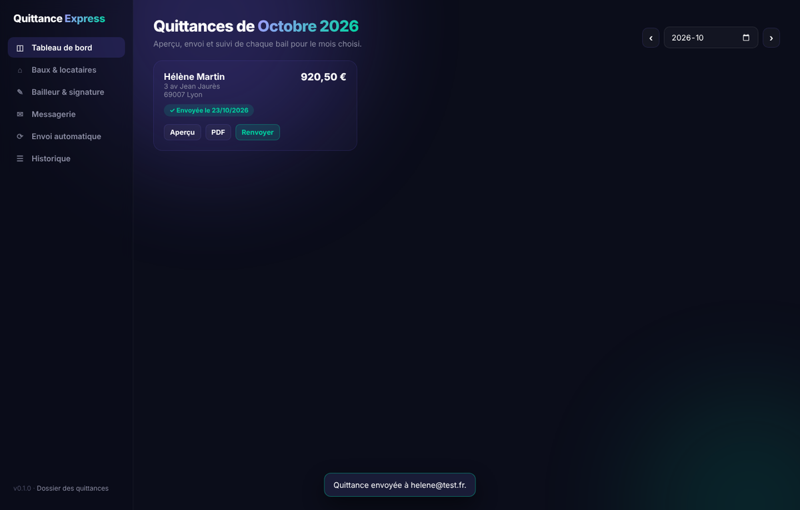
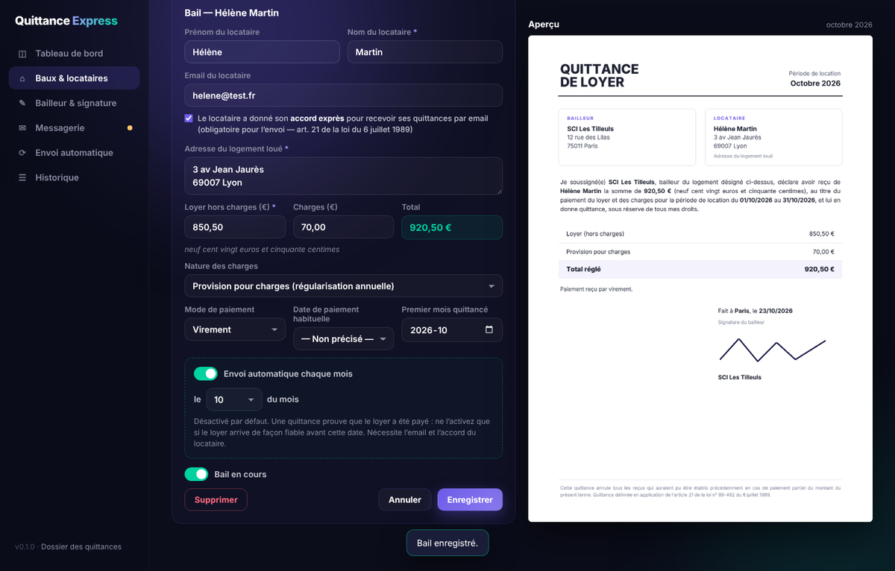
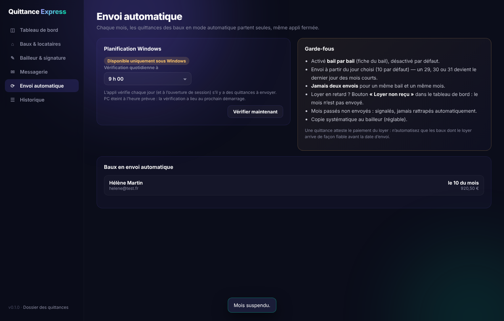

# Quittance Express

**Vos quittances de loyer, chaque mois, en un clic — ou toutes seules.**
Application Windows gratuite et open source : génération de quittances PDF conformes, envoi par email **depuis votre propre boîte** (PDF en pièce jointe), et envoi automatique mensuel.

Par [Goiz Tech Advisory](https://goiztechadvisory.fr) · Licence MIT



---

## Fonctionnalités

- **Quittance conforme** (art. 21 de la loi n° 89-462 du 6 juillet 1989) : bailleur, locataire, adresse du logement, période, loyer et charges détaillés, montant en chiffres **et en lettres**, date et mode de paiement, signature.
- **Plusieurs baux** : un par logement loué, informations reprises chaque mois.
- **Aperçu en direct** du PDF.
- **Envoi par email depuis votre boîte** : Gmail, Outlook.com / Hotmail / Microsoft 365, OVH, Orange, Free, SFR, La Poste, Yahoo, iCloud ou tout serveur SMTP. Copie automatique au bailleur.
- **Envoi automatique** le jour choisi de chaque mois, même application fermée (tâche planifiée Windows).
- **Historique** et **archivage** de chaque PDF dans `Documents\Quittances\AAAA\`.
- **Import** des modèles exportés depuis [goiztechadvisory.fr/quittance](https://goiztechadvisory.fr/quittance/), sauvegarde/restauration de vos données.

| Fiche d’un bail avec aperçu en direct | Envoi automatique et garde-fous |
|---|---|
|  |  |

## Installation

1. Téléchargez `QuittanceExpress-Setup-x.y.z.exe` dans les [Releases](https://github.com/Goiz-Tech-Advisory-Lab/quittance-express/releases/latest).
2. Lancez-le (pas besoin de droits administrateur).

> **« Windows a protégé votre ordinateur » ?** L’installateur n’est pas encore signé par un certificat de signature de code.
> Cliquez sur **Informations complémentaires → Exécuter quand même**. Le code source est public et l’exécutable est construit par GitHub Actions à partir de ce dépôt.

Configuration requise : Windows 10 ou 11 (le moteur d’affichage Microsoft Edge WebView2 est déjà présent sur ces versions).

## Premiers pas

1. **Bailleur & signature** : nom, adresse, email, ville, puis importez l’image de votre signature.
2. **Baux & locataires** : créez un bail par logement (locataire, email, adresse, loyer, charges). Pour l’envoi par email, cochez l’**accord exprès du locataire** (exigé par l’article 21 de la loi du 6 juillet 1989 pour la transmission dématérialisée).
3. **Messagerie** : choisissez votre fournisseur et connectez votre boîte (voir ci-dessous), puis « Envoyer un email de test ».
4. **Tableau de bord** : pour chaque bail du mois, *Aperçu*, *PDF*, *Envoyer*, ou *Loyer non reçu*.

### Messageries

| Messagerie | Ce qu’il faut |
|---|---|
| Gmail | Un **mot de passe d’application** (validation en 2 étapes requise) : <https://myaccount.google.com/apppasswords> |
| Outlook.com / Hotmail / Microsoft 365 | Bouton **« Se connecter avec Microsoft »** (aucun mot de passe stocké) |
| Yahoo, iCloud | Un mot de passe d’application |
| OVH, Orange, Free, SFR, La Poste | Le mot de passe de la boîte |
| Autre | Serveur SMTP, port, sécurité (SSL/TLS ou STARTTLS) |

Les mots de passe sont stockés dans le **Gestionnaire d’identifiants Windows**, jamais dans un fichier. La connexion Microsoft est conservée chiffrée (DPAPI).

## Envoi automatique — à lire

Une quittance **atteste que le loyer a été payé**. Envoyée alors que le loyer n’est pas arrivé, elle peut être utilisée contre le bailleur. D’où les garde-fous :

- activé **bail par bail**, **désactivé par défaut**, avec un avertissement à l’activation, et seulement si le locataire a accepté l’envoi par email ;
- envoi à partir du jour choisi (**10** par défaut ; 29-31 → dernier jour des mois courts) ;
- **jamais deux envois** pour un même bail et un même mois ;
- bouton **« Loyer non reçu »** : le mois n’est pas envoyé, et les mois suivants ne partent plus automatiquement tant qu’il n’est pas réactivé ;
- la date de paiement n’est imprimée que sur les quittances envoyées manuellement (jamais sur un envoi automatique, où elle n’a pas été constatée) ;
- mois passés non envoyés : signalés, **jamais rattrapés automatiquement** ;
- copie systématique au bailleur (désactivable).

La planification s’active dans **Envoi automatique** : une tâche Windows vérifie chaque jour (et à l’ouverture de session) s’il y a des quittances à envoyer, avec rattrapage si le PC était éteint. Journal : `%APPDATA%\QuittanceExpress\logs\quittance.log`.

## Vos données

| Quoi | Où |
|---|---|
| Bailleur, baux, historique, signature | `%APPDATA%\QuittanceExpress\` |
| Quittances PDF, sauvegardes | `Documents\Quittances\` |
| Mots de passe | Gestionnaire d’identifiants Windows |

Rien n’est envoyé à Goiz Tech Advisory : l’application ne communique qu’avec votre messagerie. La désinstallation supprime la tâche planifiée et conserve vos données et quittances.

## Développement

```bash
python -m venv .venv && .venv\Scripts\activate
pip install -e ".[dev]"
python -m playwright install chromium   # pour le test d’interface
python -m pytest -q
python -m quittance                     # lance l’application
```

Architecture : Python (génération PDF `fpdf2`, aperçu `pypdfium2`), serveur HTTP local lié à `127.0.0.1` avec jeton de session, interface HTML/JS dans une fenêtre `pywebview` (WebView2). Exécutable : PyInstaller ; installateur : Inno Setup ; publication : GitHub Actions sur tag `v*`.

### Outlook / Microsoft 365 : identifiant d’application

L’envoi via Outlook utilise Microsoft Graph (`Mail.Send`, autorisation déléguée) avec une application Entra « client public ».
L’identifiant (non secret) est défini dans `src/quittance/mailer.py` (`DEFAULT_MS_CLIENT_ID`) et peut être remplacé dans l’écran **Messagerie**.
Pour créer le vôtre : Entra → Inscriptions d’applications → comptes organisationnels **et** personnels, URI de redirection *Client public* `http://localhost`, « Autoriser les flux clients publics » = Oui, autorisation déléguée Microsoft Graph `Mail.Send`.

## Avertissement

Outil fourni gratuitement, sans garantie. Il ne constitue pas un conseil juridique : vérifiez les informations de vos quittances.
